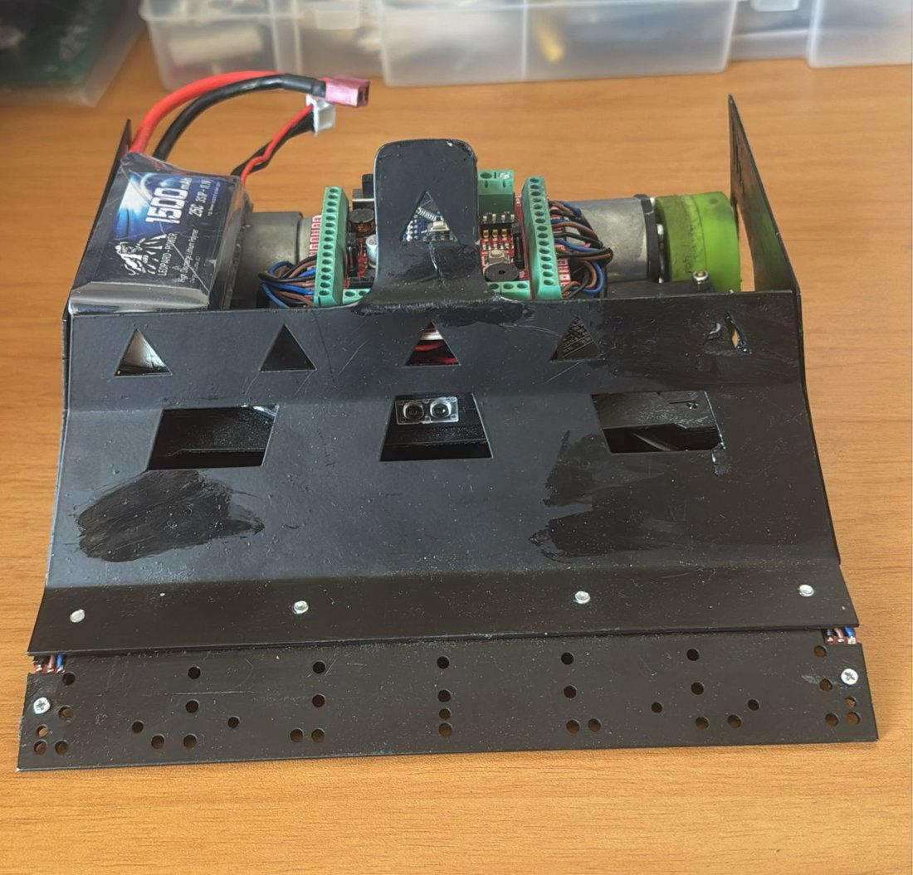
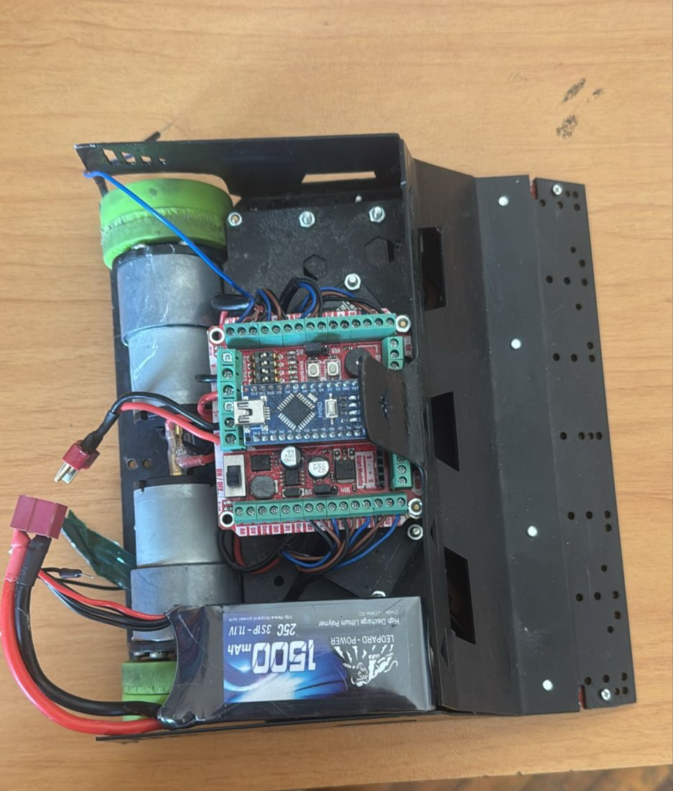

<h1 align="center">GladiatrAZE — Autonomous Sumo Robot</h1>

<p align="center">
  Arduino Nano firmware for an autonomous sumo robot: five opponent sensors, two ring-edge sensors,<br>
  an IR start module and DIP-switch-selectable opening strategies.
</p>

<p align="center">
  
  
  
  
</p>

---

<table>
  <tr>
    <td width="50%"></td>
    <td width="50%"></td>
  </tr>
  <tr>
    <td><sub>Front: the steel wedge, with windows for the opponent sensors.</sub></td>
    <td><sub>Inside: Arduino Nano on the controller board, two gear motors and a 3S LiPo.</sub></td>
  </tr>
</table>

## Hardware

| Part | Details |
|---|---|
| Weight | 1.5 kg |
| Controller | Arduino Nano on a sumo controller board with a dual motor driver, DIP switches, buzzer and start-module header |
| Drive | 2 × DC gear motors, differential drive |
| Battery | 3S LiPo, 11.1 V, 1500 mAh |
| Opponent sensors | 5 digital sensors: left, front-left, front, front-right, right |
| Edge sensors | 2 analog line sensors under the front edge |
| Start | IR start module (standard sumo start/stop remote) |

### Pin map

| Function | Pin | Function | Pin |
|---|---|---|---|
| Left motor PWM | D5, D6 | Left line sensor | A3 |
| Right motor PWM | D9, D10 | Right line sensor | A2 |
| Opponent: left | A1 | Opponent: front-left | D4 |
| Opponent: front | D3 | Opponent: front-right | D7 |
| Opponent: right | D8 | IR start module | D11 |
| LED / buzzer | D13 | Strategy DIP switches | A5 (DS3), A4 (DS4) |

In the code, `sol` means left, `sag` means right and `on` means front.

## Strategy

```
           IR start HIGH                    opponent close / to the side
  WAIT ───────────────► OPENING ──► DEFENCE ─────────────────────────────► ATTACK
   ▲                    (DS3/DS4)                                              │
   └──────────────────────────── IR start LOW (stop) ──────────────────────────┘
                        ring edge seen in any state → back up and turn away
```

1. **Wait.** The robot sits still until the IR start module fires. Meanwhile the LED shows whether any opponent sensor sees something, which helps check sensors before a match.
2. **Opening move**, chosen with the DIP switches before the round. ON means the switch is closed, which reads as LOW.

   | DS3 | DS4 | Opening |
   |---|---|---|
   | ON | OFF | Left flank: turn left, drive forward, turn back |
   | OFF | ON | Right flank: turn right, drive forward, turn back |
   | ON | ON | Straight charge |
   | OFF | OFF | Short back-off |

3. **Defence.** If the opponent is straight ahead, the robot holds position for about 0.8 s and lets it come onto the wedge. If it shows up to the side, the robot turns to face it and switches to attack.
4. **Attack.** It charges when the front sensor sees the opponent, and turns towards whichever side sensor fires. If it loses track, it spins towards the side where the opponent was last seen.
5. **Edge avoidance** comes first in every state. When a line sensor sees the white ring edge, the robot reverses and turns away from that side.
6. **Stop.** When the referee's remote sends stop, the motors stop and the robot returns to *Wait*.

## Build & flash

Open `Thunder_sumo/Thunder_sat.ino` in the Arduino IDE, select **Arduino Nano** (ATmega328P), and upload. No external libraries are needed.

## Code review fixes

These are the changes from the version used in competition. Re-test them on the robot before a match.

- **Motor speed control.** `Set_Motor()` used `digitalWrite()` with speed values, so any non-zero speed meant full power. It now uses `analogWrite()`, so slower moves like the search spin (70%) and the soft turns (50%) actually run slower.
- **Defence priorities.** The checks for "front plus front-left or front-right" came after "front only", so they could never trigger. They're now checked first.
- **Unreachable statements.** A few lines came after a `goto` and never ran, so the last-seen side wasn't updated in defence mode. They now run before the jump.
- **Start-up beeps.** `tone()` doesn't block, so the second and third beeps overwrote each other. Each one now gets its own delay.
- **Tidying.** Added named constants for the line threshold and the last-seen side, removed unused variables, and documented that DS1/DS2 on A6/A7 can't be read with `digitalRead()` on a Nano.

## License

[MIT](LICENSE)
